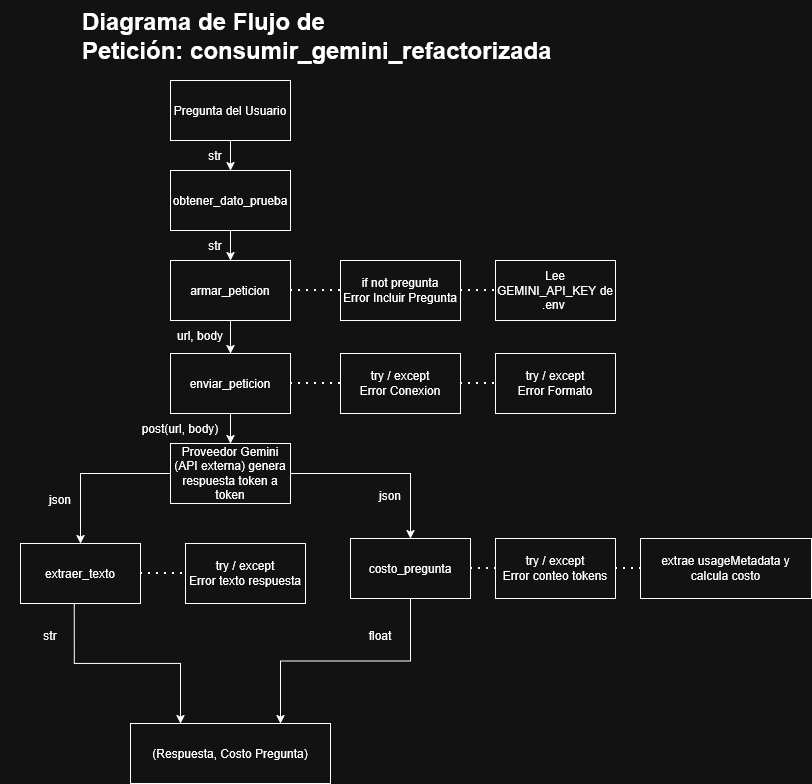

# Decisión de arquitectura: elección de modelo

## Modelo elegido

**Gemini 3.5 Flash-Lite** (`gemini-3.5-flash-lite`), para la funcionalidad principal de la miniaplicación.

## Diagrama de arquitectura

El flujo completo va desde la pregunta del usuario hasta la respuesta final, pasando por `obtener_dato_prueba`, `armar_peticion`, `enviar_peticion` (con la credencial `GEMINI_API_KEY` leída desde `.env` y el manejo de errores en `try/except`), `extraer_texto` y `costo_pregunta` (que calcula el costo a partir de `usageMetadata`). El diagrama completo está en `docs/diagrama_flujo.drawio.png`.

## Comparación de candidatos

| Criterio | Gemini 3.5 Flash-Lite | Gemini 3.5 Flash | Gemini 3.6 Flash |
|---|---|---|---|
| Costo por 1000 tokens de entrada | 0,000300 USD | 0,000750 USD | 0,000750 USD |
| Costo por 1000 tokens de salida | 0,002500 USD | 0,003750 USD | 0,003750 USD |
| Latencia promedio observada | 2,0 segundos | 6,1 segundos | 7,4 segundos |
| Calidad de respuesta para el caso | Buena: concisa, rápida y cumple con el límite de 20 palabras | Muy buena: redacción fluida y bien balanceada | Muy buena: mayor vocabulario y detalle descriptivo |
| Fecha de medición | 2026-10-20 | 2026-10-20 | 2026-10-20 |

## Justificación

Para esta miniaplicación, que requiere un asistente simple y ágil donde responder de forma concisa y directa es suficiente para la experiencia del usuario, el criterio decisivo fue la combinación de **latencia y costo**:
- **Latencia:** `gemini-3.5-flash-lite` responde en ~2,0 segundos, siendo 3 veces más veloz que `gemini-3.5-flash` (~6,1 s) y más de 3,5 veces más rápido que `gemini-3.6-flash` (~7,4 s).
- **Costo:** `gemini-3.5-flash-lite` es 2,5 veces más económico en tokens de entrada y 33% más barato en tokens de salida.

Por lo tanto, `gemini-3.5-flash-lite` ofrece la mejor relación costo-rendimiento y la menor latencia de respuesta para este caso de uso.

## Alternativas descartadas y por qué

Se descartaron **Gemini 3.5 Flash** y **Gemini 3.6 Flash**. Aunque ambos modelos demuestran una redacción con matices descriptivos adicionales, tardan entre 3 y 4 veces más en responder y tienen un costo superior por token. Para consultas breves como las requeridas en esta aplicación, ese tiempo de espera adicional afecta negativamente la fluidez del usuario sin aportar una ventaja determinante.
